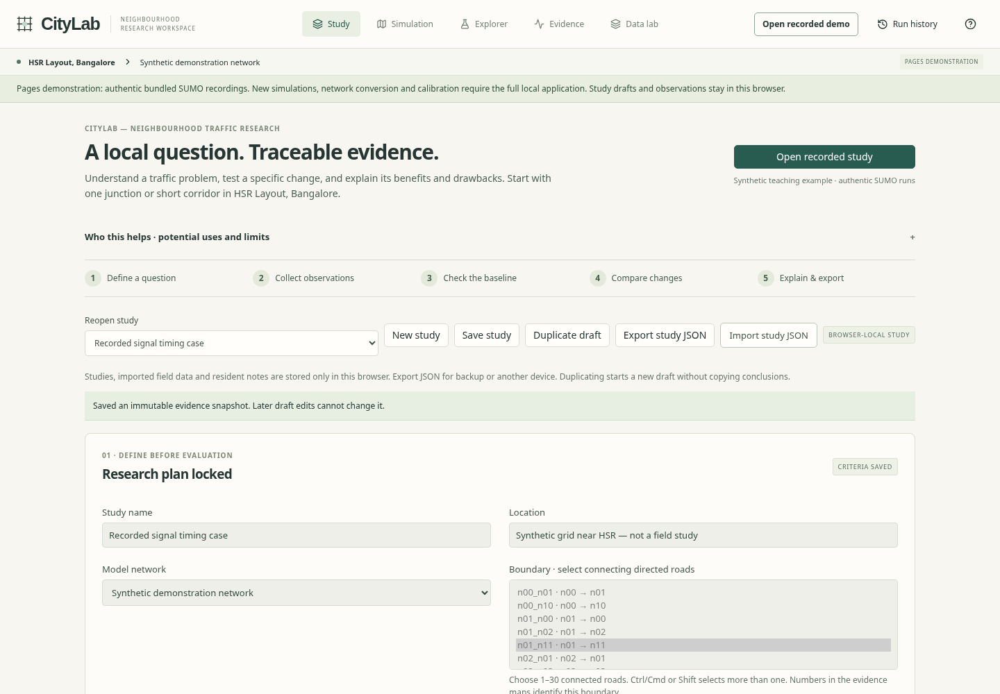
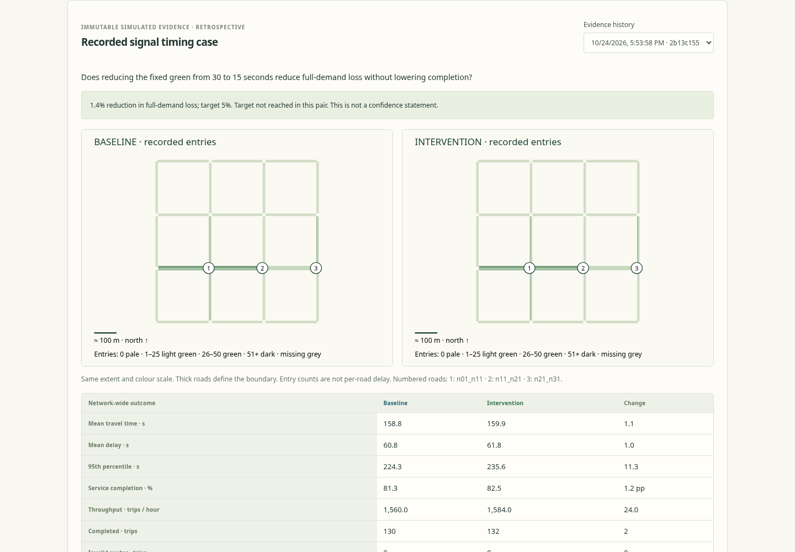

# CityLab — Neighbourhood Traffic Research

Can we understand a local traffic problem, test a specific change, and explain its benefits and drawbacks using traceable evidence?

CityLab supports that workflow for a junction or short corridor in **HSR Layout, Bangalore**: define a question → collect observations → check the baseline → compare interventions → explain results → export a planning brief. It preserves the original React/TypeScript, FastAPI, SUMO and MapLibre application, its recordings, experiment search, calibration and evidence exports.

**Research software, not live traffic, an official planning service or a validated digital twin.** Bundled traffic and observations are synthetic. The separate HSR OpenStreetMap network is geographic data, not evidence of local traffic performance. No police adoption, approval or proven local impact is claimed.

## Demonstration and downloads

- Repository: <https://github.com/Modeldog8197/traffic-sim>
- Pages target: <https://modeldog8197.github.io/traffic-sim/> — see [actual deployment status](docs/RESEARCH-VERIFICATION.md); this configured address is not proof of publication.
- [Verified release source ZIP](https://github.com/Modeldog8197/traffic-sim/archive/refs/tags/v2.1.0.zip) · [Release notes](https://github.com/Modeldog8197/traffic-sim/releases/tag/v2.1.0) · [Interface screenshots](docs/screenshots/).
- [Field collection guide](docs/FIELD_GUIDE.md) and [methodology](docs/METHODOLOGY.md).





## Who this helps

**Traffic police and planners:** investigate queues and bottlenecks; compare signal timings and supported bus priority; explore temporary restrictions with departure routing; check whether another approach gets worse; prepare evidence for further review. Operational decisions require qualified local review.

**Residents and neighbourhood associations:** understand a proposed street change, compare nearby roads, record recurring problems and discuss maps and evidence. Resident notes are unverified, browser-local and exportable. Nothing is sent to authorities; do not include names, contacts, number plates or other personal identifiers.

## Capabilities

- A guided study workspace for 1–30 connected directed roads, including location, question, boundary, intervention, primary outcome, success target, sources, assumptions, limitations and notes.
- Save, reopen, duplicate and JSON import/export. Studies and dated observations use browser storage in both modes; export backups before clearing data or moving devices. No account synchronisation is implied.
- Immutable snapshots preserve exact configurations, run IDs, network/manifest hashes, measurements, observations and research plans. Revising a draft cannot alter historical evidence. SHA-256 export checks detect changed snapshots; they are integrity checks, not authenticated signatures.
- Lock criteria before evaluation; attaching older runs is marked **retrospective**. The recorded example is not preregistered research.
- Dated CSV templates, an example copied from authentic synthetic counts, explicit road mapping, unit/range/date/time-zone checks and overlap/duplicate rejection. Calibration, validation and context remain distinct.
- Local bounded demand calibration on early intervals, followed by untouched intervals with different seeds. The Study handoff records the dataset ID, fit boundary and validation boundary; configure that dataset and the stated horizon in Data lab.
- Paired recorded playback, road/junction inspection, signal decisions, completed and unfinished outcomes, class/OD effects, independent-seed uncertainty, held-out demand conditions, unsuccessful candidates and reproducibility exports.
- Deterministic resident explanations and self-contained HTML planning briefs with matched maps, actual metrics, road-entry effects, adverse groups, provenance, assumptions and run IDs. Open a brief and choose **Print / save as PDF**. Explorer retains direct HTML/PDF/ZIP exports.

The teaching comparison is deliberately mixed: fixed green 30 → 15 s, seed 42, 160 requests, 300 s evaluation. Completion increases **130 → 132 trips**, completed-trip mean increases **158.8 → 159.9 s**, and full-demand loss falls **225.2 → 222.0 s/request**. The example's 5% loss-reduction target is not reached (about 1.4%). These are authentic SUMO outputs, not Bangalore measurements.

## Two modes

| Capability | Pages demonstration | Full local application |
|---|---|---|
| Reviewed recordings and research results | Static JSON/frame chunks | Yes |
| Studies, dated observations, resident notes | Browser-local | Browser-local |
| Recorded comparison and available evidence exports | Yes | Yes |
| New simulations or experiment searches | Disabled with explanation | SUMO |
| OSM import, calibration, detailed playback reproduction | Disabled with explanation | Python/SUMO |
| Scenario drafts | Browser-local | Backend database |

Pages never queues a fake job or presents cached results as a new run. It makes **no `/api/` requests**. The build reads only reviewed `examples/`, never local databases or private observations: 478 recorded jobs, three completed research/calibration tasks, available playback and HSR geometry. Shared network descriptions are de-duplicated without modifying source evidence. Metrics-only experiments require the full application to reproduce detailed playback.

## Full local setup

Use Python **3.12**, Node **22 or 24**, and pnpm **10.15.0**. The pinned Linux requirements install SUMO 1.27.1, TraCI and sumolib; there is no substitute engine. Run from the repository root:

```bash
python3.12 -m venv .venv
. .venv/bin/activate
python -m pip install -r requirements.lock.txt
python -m pip check
npm install --global pnpm@10.15.0
pnpm --dir frontend install --frozen-lockfile
pnpm --dir frontend build
python -m uvicorn backend.api:app --host 127.0.0.1 --port 8000
```

Open the local application on port 8000. Startup idempotently installs the reviewed recordings and HSR network. Ignored `data/` holds the database and runs; `CITYLAB_DATA` can select a separate directory. Preserve it on restart. Do not run two API processes against one data root. The backend has no multi-user authentication: keep it bound to loopback.

For development, keep the API running and start `pnpm --dir frontend dev` in another terminal. Vite proxies `/api` to port 8000; `CITYLAB_API_TARGET` can select another local address. After building Pages, rebuild without `VITE_DEMO` before using `frontend/dist` for the full app.

No paid language-model API, live traffic service or remote map tile service is required. Internet is needed for package installation and publishing, not ordinary local analysis.

## Static build and checks

```bash
python -m scripts.build_pages_data
pnpm --dir frontend build:pages
mkdir -p /tmp/citylab-site
ln -s "$PWD/frontend/dist" /tmp/citylab-site/traffic-sim
python -m http.server 4173 --bind 127.0.0.1 --directory /tmp/citylab-site
```

Use the `/traffic-sim/` subpath. Direct navigation uses `#study`, `#workspace`, `#explorer`, `#evidence` and `#data`, so no rewrite server is required. GitHub Actions checks the source and browser journeys before deploying the artifact. Repository **Settings → Pages → Source → GitHub Actions** must be enabled with the required administration permission.

```bash
python -m pytest -q
pnpm --dir frontend test
node scripts/test_interpolation.cjs
pnpm --dir frontend exec playwright install --with-deps chromium
# Keep the static server above running:
node scripts/browser-research.mjs
```

The browser script uses system Chromium or Playwright's browser; `CHROME_PATH` overrides it. `CITYLAB_BROWSER_URL`, `CITYLAB_BROWSER_OUTPUT` and `CITYLAB_TEST_LOCAL=1` support the full local journey. Outputs go to ignored `test-results/`. See [verification](docs/RESEARCH-VERIFICATION.md) for actual results and untested platforms.

## Evidence limitations

- Passenger cars and buses only: motorcycles, auto-rickshaws, pedestrians, cyclists and local heterogeneous lane behaviour are not adequately represented.
- Road entries can fit/check demand. Mean entry speed can check a matching positive count interval. Turning counts, queue snapshots and green times remain contextual; automatic calibration of these measurements is not implemented.
- Fitting a limited demand model does not validate all junction dynamics. Keep days and fitting/validation periods separate. MAE includes measured zeros; unavailable speeds remain missing. No real field data is supplied.
- Compatibility requires matching network, trip manifest, horizon, warm-up, engine, measurement definition, routing and occupancy. Completed averages exclude unfinished trips; inspect full-demand outcomes alongside them. Missing values appear as **—**, never zero.
- Routes are chosen before departure. Tested closures change feasible departure routes and can invalidate services; no within-trip dynamic diversion or adaptive traveller response is predicted.
- Road-level evidence uses recorded entries and mean entry speed, never a fabricated allocation of network-wide delay. Paired maps share extent and legend.
- One seed pair has no confidence interval. Explorer's independent seeds are replicates; vehicles within a run are not. Study briefs do not silently substitute unrelated Explorer results into the selected pair.
- Person weighting uses assumed occupancy; emissions use SUMO classes. HSR geometry has disconnected components and inferred/default attributes. Review directions, permitted turns, lanes, signals, bus services and local vehicle mix before a field study.

## Architecture and recovery

`frontend/src/research/` holds observation validation, study persistence, evidence and reports. `StudyWorkspace.tsx` connects these to the original simulation UI. `api.ts` selects the backend or static recording adapter in `demo.ts`. `backend/` retains simulation, routing, import, calibration, statistics and exports. `scripts/build_pages_data.py` generates ignored static assets from reviewed `examples/`.

The prior upload flattened the original folders. The source ZIP was recovered and all **2,578 manifest-listed files** were verified before restoring the structure and preserving Git history. [The original manifest](docs/ORIGINAL-RELEASE-MANIFEST.json) describes the prior release, not this modified source. Older `v2-*` screenshots and verification documents are historical; current screenshots are in `docs/screenshots/`.

See [architecture](docs/ARCHITECTURE.md), [methodology](docs/METHODOLOGY.md), [original case](docs/CASE_STUDY.md) and [implementation checklist](docs/IMPLEMENTATION.md). Geographic data: © OpenStreetMap contributors, ODbL; provenance is retained with the HSR extract.
